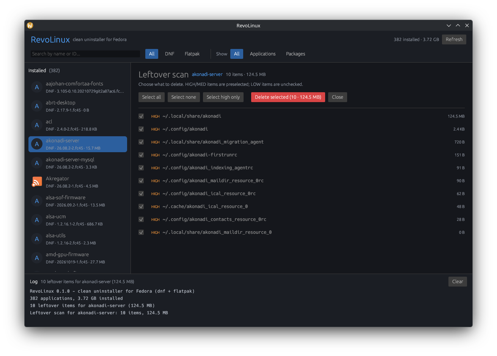

# RevoLinux

A Revo Uninstaller-style **clean uninstaller for Fedora Linux**, written in Rust.
It removes an application with DNF or Flatpak, then scans for the files the
package manager leaves behind and lets you pick exactly what to delete.



RevoLinux is an independent project. It is inspired by the workflow of Revo
Uninstaller on Windows, but it works with Linux package managers and the Linux
filesystem. There is no registry.

## Features

- **Scan leftovers after an app is already gone**: search its name, click
  *Scan leftovers* (CLI: `revolinux scan vscode`), review and delete.
- **Launcher-style search**: exact, full prefix, word prefix, acronym (`vsc`
  → Visual Studio Code) and subsequence (`vscode`, `ffx` → Firefox), with
  ranked results and automatic selection of the best match.
- **Application icons** resolved from the desktop entry and the active icon
  themes (hicolor, Breeze, Adwaita, Papirus), with a letter fallback.
- **One application list** for DNF packages and Flatpak apps, with filters for
  source (DNF/Flatpak) and kind (**Applications** = has a visible `.desktop`
  entry, **Packages** = libraries and other non-GUI packages).
- **Uninstall with the native tool**: `dnf5 remove` or `flatpak uninstall`.
- **Purge scan after removal** for leftover config, cache, state, data, temp,
  desktop entries, icons, autostart entries, systemd units and app-data folders.
- **Per-item choice**: every leftover path has a checkbox and a confirmation
  dialog before anything is deleted.
- **Confidence levels**: HIGH/MED items are preselected, LOW items are shown but
  left unchecked.
- **RPM ownership guard**: files that still belong to another installed RPM are
  never offered as leftovers.
- **Polkit integration**: deleting system paths (`/etc`, `/usr/share`, ...)
  raises the normal KDE/GNOME password prompt through `pkexec`.
- **No root daemon**, no background service, no telemetry.
- **CLI mode** for scripting and testing.

## Requirements

- Fedora with `dnf5` (Fedora 41+).
- Flatpak is optional; the Flatpak backend is skipped when it is not installed.
- A polkit authentication agent (KDE Plasma and GNOME provide one).
- To build: Rust 1.80+ and a C linker. On a normal Fedora workstation:

  ```bash
  sudo dnf install cargo rust gcc
  ```

  Or use rustup: <https://rustup.rs>.

## Build and run

```bash
cargo build --release
./target/release/revolinux
```

Install the binary, desktop entry and icon into `/usr/local`:

```bash
make install
```

Install for the current user only (no root, appears in the app menu):

```bash
PREFIX="$HOME/.local" packaging/install.sh
```

Remove it again:

```bash
make uninstall
```

## Prebuilt binary (no build needed)

**Download page:** <https://lsupwp.github.io/Revo-Uninstall-Clone-Linux-/>

```bash
curl -LO https://github.com/lsupwp/Revo-Uninstall-Clone-Linux-/releases/download/v0.1.0/revolinux-0.1.0-x86_64-unknown-linux-gnu.tar.gz
tar -xzf revolinux-0.1.0-x86_64-unknown-linux-gnu.tar.gz
./revolinux/install.sh          # or PREFIX="$HOME/.local" ./revolinux/install.sh
```

The tarball contains the static-ish `revolinux` binary, the icon, the desktop
entry and `install.sh`. Verify with the `.sha256` file beside it.

### Publishing a new release

`packaging/make-dist.sh` builds the tarball and regenerates the download page
in `docs/`. `packaging/publish-release.sh` additionally publishes the binary to
GitHub Releases without the GitHub CLI:

1. Push a commit that changes the version in `Cargo.toml`.
2. Run `packaging/publish-release.sh` (or with an explicit tag).

The script pushes the tarball as a commit on the `build-assets` branch, tags the
current `main` commit and pushes the tag. The tag triggers
`.github/workflows/release.yml`, which attaches the asset to the Release.
Enable GitHub Pages once (Settings → Pages → Source: *Deploy from a branch*,
branch `main`, folder `/docs`).

## Usage

1. Start `revolinux`.
2. Pick an application in the left list (search and DNF/Flatpak filters work).
3. Click **Uninstall / Purge...**.
4. Confirm the uninstall. Leave *Scan for leftover files after removal* enabled.
5. Review the leftover list. Check or uncheck each path.
6. Click **Delete selected**, then confirm the permanent deletion.

Flatpak app data (`~/.var/app/<app-id>`) is not deleted by default during
uninstall. It appears in the leftover list instead, so you can decide per item.
To remove it in the same step, enable *Also delete flatpak app data* in the
confirmation dialog.

## CLI

```bash
revolinux list                     # all applications
revolinux list --json
revolinux scan <id>                # leftover scan without uninstalling
revolinux scan <id> --json
revolinux purge <id> --dry-run     # read-only leftover preview, no changes
revolinux purge <id> --yes         # uninstall + delete HIGH/MED leftovers
```

`<id>` can be a DNF package name (`akregator`), a Flatpak application ID
(`org.videolan.VLC`), or the exact application name.

`purge` only deletes HIGH and MED confidence paths. LOW-confidence paths are
printed in the scan but never deleted automatically.

## How the leftover scan works

RevoLinux looks at the direct contents of these locations (depth 2-3 for a few
trees):

| User paths | System paths |
| --- | --- |
| `~/.config` | `/etc` |
| `~/.local/share` | `/etc/xdg/autostart` |
| `~/.local/state` | `/etc/systemd/system` |
| `~/.local/bin` | `/opt` |
| `~/.local/share/applications` | `/usr/local` |
| `~/.local/share/icons` | `/usr/share/applications` |
| `~/.cache` | `/usr/share/pixmaps` |
| `~/.var/app` | `/usr/share/icons/hicolor` |
| `~/.config/autostart` | `/usr/share/doc` |
| `/tmp`, `/var/tmp` | `/var/cache`, `/var/log`, `/var/lib` |
|  | `/usr/lib/systemd/system` |

It builds name tokens from the package name and ID. Examples:

- `google-chrome-stable` also matches `google-chrome` and `chrome`.
- `org.videolan.VLC` also matches `vlc` and `VLC`.
- `akonadi-server` also matches `akonadi`.
- `Visual Studio Code` also matches `code` and `visual-studio-code`.

Matching rules produce the confidence level:

- **HIGH**: exact name, or name plus a separator/digit/`rc` suffix
  (`vim` → `.vimrc`, `code` → `Code`, `foo` → `foo.desktop`).
- **MED**: short prefix matches.
- **LOW**: substring matches with tokens of 5+ characters.

Only paths inside the scan roots are considered. A path equal to a scan root,
the home directory, `/`, or any path containing `..` is refused. Package-owned
RPM files are removed from the candidate list. Files are measured before they
are shown, so the list includes sizes.

## Safety model

- Uninstalling is always done by `dnf5` or `flatpak`, never by deleting package
  files directly.
- Leftover deletion is opt-in per path and needs a second confirmation.
- HIGH/MED paths are preselected; LOW paths are not.
- System paths are deleted through `pkexec` in one `rm -rf` call with `--`.
- The scanner only considers the roots listed above. Deleting a whole scan root
  or a home directory is rejected.
- Deletion is permanent. There is no trash folder. Read the list before you
  confirm.

## Limitations

- Leftover detection is heuristic. A generic package name can match unrelated
  directories; review the list. When in doubt, uncheck the item.
- There is no "traced install" mode (Revo's install monitoring), because that
  needs a background service running before installation. The post-uninstall
  scan covers the same practical cases on Linux.
- Flatpak runtimes are not listed as applications; only apps are shown.
- Only Fedora/DNF5 and Flatpak are supported today. The backend interface is
  small (`src/backends/`), so adding apt/pacman is straightforward.
- GUI is egui-based, so it does not follow the Plasma Qt theme widget by
  widget. Colors are adjusted for dark desktops.

## Project layout

```
src/main.rs        entry point, GUI setup, window icon
src/app.rs         egui UI, worker threads, state machine
src/model.rs       Package/Leftover types, name tokens, confidence
src/scan.rs        leftover scan roots, matching, safe deletion
src/backends/      dnf.rs, flatpak.rs, backend dispatch
src/exec.rs        command execution, polkit helpers
src/cli.rs         list/scan/purge commands
src/util.rs        size formatting and parsers
assets/            icon, desktop entry, screenshot
packaging/         install script
```

Tests:

```bash
cargo test
```

Developer aid: `REVOLINUX_START_SCAN=<id> ./target/debug/revolinux` opens the
leftover review for that application at startup. `REVOLINUX_SELECT=<id>`
preselects it in the list, `REVOLINUX_SEARCH=<query>` prefills the search box.

### Mesa EGL / ZINK warnings

On virtual machines you may see:

```
MESA-EGL: warning: failed to get driver name for fd -1
MESA: error: ZINK: failed to choose pdev
```

These are harmless Mesa probes before falling back to software rendering. On
VMware guests RevoLinux selects llvmpipe automatically. Elsewhere, start it
with `LIBGL_ALWAYS_SOFTWARE=1 revolinux` to silence them.

## License

MIT. See [LICENSE](LICENSE).
